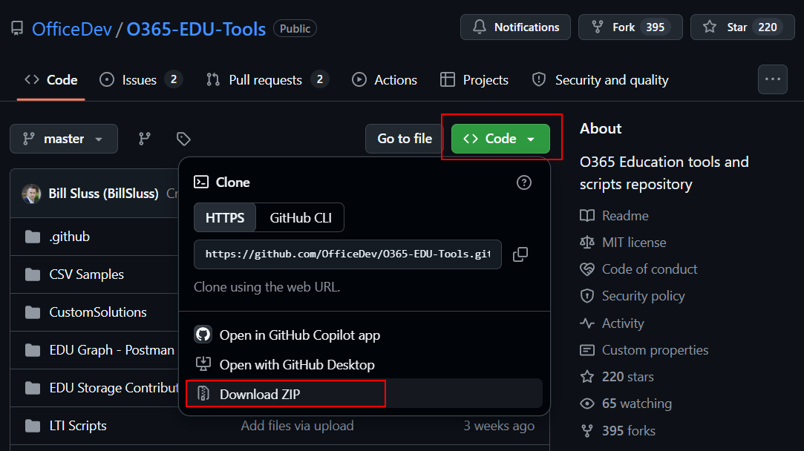
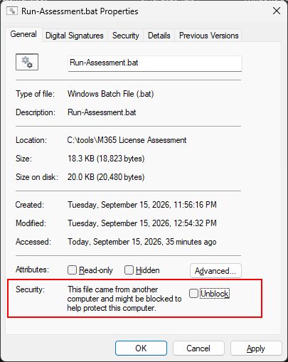
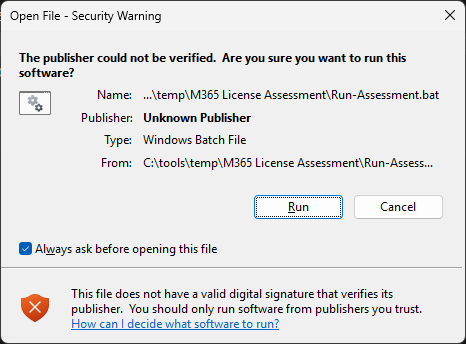
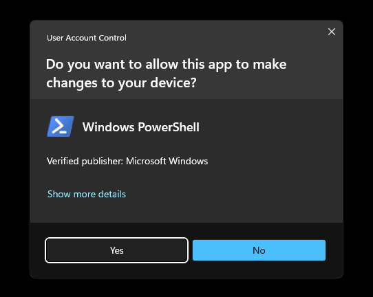
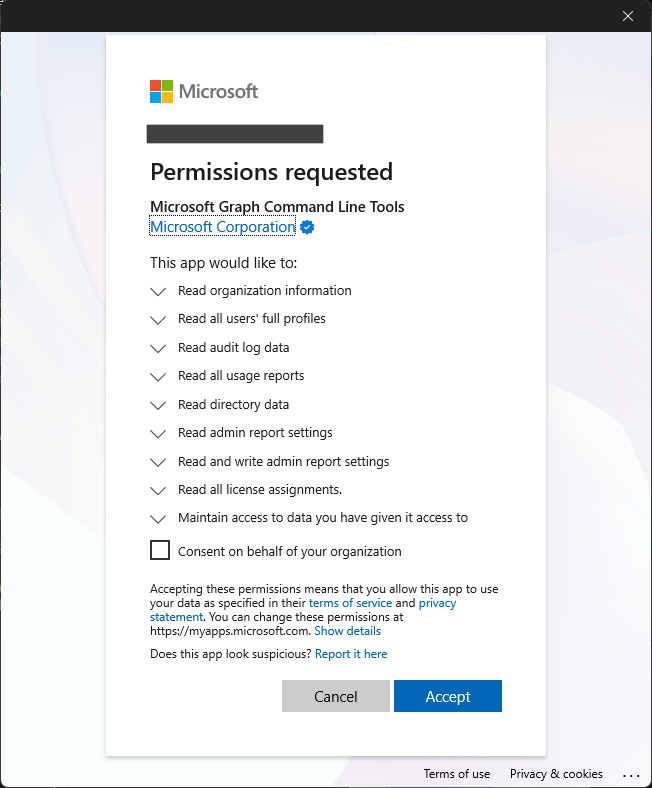
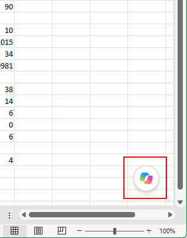

# Microsoft 365 Education usage and assessment support

Getting a handle on your organization’s Microsoft 365 licensing and usage helps you control costs, maintain licensing compliance, strengthen security, and ensure that your students, faculty, and staff have access to the tools they need.

This repo includes a PowerShell-powered tool that can help educational organizations like yours more easily gather and analyze important license and usage information. Plus, in this doc, we explain how you can use the Microsoft 365 admin center to further explore your organization’s licensing, usage, and adoption patterns.

***Please make sure you’ve thoroughly reviewed the prerequisites listed in the “How to run” section before attempting to run the tool for the first time.***

**Jump to:**

-   [What information do you need?](#what-information-do-you-need)
-   [How to run the Usage Assessment PowerShell Tool](#how-to-run-the-service-usage-assessment-powershell-tool)
-   [Explore licensing, usage, and adoption using the Microsoft 365 admin center](#explore-licensing-usage-and-adoption-using-the-microsoft-365-admin-center)

## What information do you need?

To successfully manage your Microsoft 365 licenses, you should know what licenses you have, what your users need, and what it's costing you.

When you’re collecting information about how you’re using Microsoft products and services, consider these questions:

-   How many total licensed users are in your organization? How many of your students, faculty, and staff currently have Microsoft 365 licenses?
-   What types of licenses are you currently using? For example, are you using Microsoft 365 A1, A3, or A5 licenses? And do you have any product- or service-specific licenses, like for Microsoft Copilot, Visio, or Project?
-   For each license type, how many seats are available?
-   How many of these seats are currently assigned?
-   How are students, faculty, and staff adopting and using Microsoft products and services, like Microsoft Teams, OneDrive, Exchange, SharePoint, or Copilot?
-   How many users are inactive? How many licenses are unused?
-   How much do your current licenses cost?

## How to run the Service Usage Assessment PowerShell tool

We’ve created the Microsoft 365 Service Usage Assessment PowerShell tool to help you effectively understand how your students, faculty, and staff are using Microsoft 365. This tool uses the Microsoft Graph API to pull license, user, and activity information into one concise spreadsheet. After generating this spreadsheet, you can use Copilot to generate a human-readable analytics dashboard that gives you key insights on your current licensing, adoption, and usage status. We show you how in the [Generate analytics dashboard](#generate-analytics-dashboard) section.

### Prerequisites

Before starting, make sure a few things are configured on both your Microsoft 365 tenant and your local computer.

#### Microsoft 365 account permissions

When running this tool, you’re asked to sign in with your Microsoft 365 account. To successfully pull all the required information, your account needs to have read access to user information, license information, and reports on your Microsoft 365 tenant.

Be sure that your account has one of these role assignments:

-   Global Reader
-   Directory Reader + Reports Reader

    [For more details on managing roles in Microsoft 365, go to Microsoft Learn.](https://learn.microsoft.com/microsoft-365/admin/add-users/assign-admin-roles?view=o365-worldwide)

#### Check your tenant’s concealed names setting

Microsoft 365 has an optional setting for concealing names in reporting services. When enabled, this replaces usernames in usage reports with a random identifier, which can limit the value of the data that the tool pulls and makes analysis more difficult. We recommend that you make sure this setting is disabled before running the tool.

Have your tenant administrator perform the following check:

1.  Go to the Microsoft 365 admin center.
2.  Expand **Settings**, and select **Org settings**.
3.  Open the **Services** tab, and choose **Reports**.
4.  Locate the option **Conceal user, group, and site names in all reports**. In some tenants, this reads **In all reports, display de-identified names**.
5.  Make sure that the checkbox is **cleared**. If the checkbox is selected, clear it and then select **Save**.

#### Local computer administrative access

The tool needs to run with elevated administrative privileges, which are required to install and configure the PowerShell modules it uses to interact with your Microsoft 365 tenant.

To successfully run the tool, make sure you have an administrative role on your local machine. If your local machine is managed by your organization, also ensure that your organization’s Group Policy rules or Intune configuration settings don’t prevent your machine from executing PowerShell scripts with elevated permissions.

#### Local computer configuration

The computer where you run the tool needs to meet the following requirements.

| Operating system      | Windows 10 or 11.                                                                                                                                                                                             |
|-----------------------|---------------------------------------------------------------------------------------------------------------------------------------------------------------------------------------------------------------|
| PowerShell            | 5.1 or later, as shipped standard with Windows.                                                                                                                                                               |
| Local rights          | Administrator rights on your local computer.                                                                                                                                                                  |
| Network               | Outbound access to graph.microsoft.com over standard HTTPS (TCP port 443). If you’re having trouble accessing this, consult with your network administrator.                                                  |
| Disk space            | Generally negligible; however, very large organizations may need up to 100 megabytes for local data processing.                                                                                               |
| File state            | No output file from an earlier run open. Close report.xlsx in Excel before starting, or the tool cannot write over it.                                                                                        |
| PowerShell components | The tool checks for both Microsoft.Graph.Authentication and ImportExcel and, if absent, installs them for the current user. This means that your machine needs access to the PowerShell Gallery on first run. |

### Download the tool

You need to download the tool’s files from the [O365 Education tools and scripts repository Git repo](https://github.com/OfficeDev/O365-EDU-Tools) onto your local machine before you can start using it. Do this in one of two ways:

#### Clone using Git

If you’re comfortable using Git, take the following steps to download the tool:

1.	Open a command prompt. 
2.	Go to a folder on your local system where you want to download the tool.\
3.	Enter the following Git command to clone the repo:

```code
	git clone https://github.com/OfficeDev/O365-EDU-Tools.git
```

Once cloned, you can find the tool in the **M365 License and Usage** subfolder. 

#### Download as a ZIP file

As an alternative to Git, you can download the tool’s contents as a ZIP file:

1.  Navigate to [the repo](https://github.com/OfficeDev/O365-EDU-Tools) in your browser, select **Code**, and then choose **Download ZIP**. 
2.  Extract the contents of the ZIP file to the location you want to run it from.



After extracting, you can find the tool in the **M365 License and Usage** subfolder. 

### Prepare the tool for first run

Before running the tool for the first time, verify a few things on your local copy.

#### Ensure that required files are in place

First, be sure that the files you downloaded are in the correct location. Go to the folder where you cloned or download the repo to, and verify that the following files are present in the **M365 License and Usage** subfolder:

-   **Assessment Script.ps1**. The PowerShell script that performs the bulk of the data pulls and consolidation.
-   **Run All Services Assessment.bat**. A batch file that you use to launch the PowerShell file.
-   A **Reference** folder. This should contain a single file named **ServicePlanFriendlyNames.csv**, which is used to substitute raw Microsoft internal IDs with readable service names. The tool will run without it, but service names in the resulting output may not be legible.

#### Confirm that the launcher batch file is unblocked

By default, Windows blocks execution of any batch files downloaded from the internet. Before running the tool for the first time, make sure that this block is removed:

1.  In Windows Explorer, go to the folder where you’ve downloaded the tool files.
2.  Right-click the **Run All Services Assessment.bat** file, and select **Properties**.
3.  On the **General** tab, look for a **Security** section at the lower edge of the window.
4.  If there’s an **Unblock** checkbox, select it.
5.  Select **Apply**, and then, to confirm, select **OK**.  
    

### Run the tool

After you’ve downloaded and prepared the tool files, you’re ready to start using them:

1.	In Windows Explorer, go to the folder where you’ve cloned or downloaded the tool files, then navigate to the **M365 License and Usage** subfolder. 
2.  Double-click **Run All Services Assessment.bat**.
    -   You may receive a security warning when running the batch file. You can safely select **Run** to proceed.  
        
    -   A PowerShell console window appears, and you’ll see a welcome message explaining what the Service Usage Assessment tool will do.
3.  Press any key on your keyboard to continue.
    -   A User Account Control prompt will ask you to grant access to PowerShell. Select Yes.
        
    -   The PowerShell script will start, and you’ll be shown a login prompt.
1.  Sign in using your Microsoft 365 account (with the required permissions outlined in the [Prerequisites](#prerequisites) section).
    -   On the first run, you may be asked to grant the Microsoft Graph Command Line Tools access to your organization’s data. To proceed, accept this request.  
        

After you sign in, the tool starts to process your tenant information. This may take several minutes, depending on your organization’s size and user count. When it’s done, it generates an Excel file named “AdoptionReport [time and date of run].xls” in the tool folder, automatically opens that file in Excel, and then closes the PowerShell window.

In addition to the final Excel file, the tool generates a **Resources** folder where you can find raw data and log files. In case of errors, consult the **Errors** and **Logs** files in this folder.

Note: To avoid file access errors, make sure that you close any generated files before running the tool again.

### Generate analytics dashboard

After creating the report Excel file, you can prompt Copilot to quickly and easily generate a human readable analytics dashboard:

1.  Open the “AdoptionReport” Excel file.
2.  In Excel, select the **Copilot** icon.   
    
3.  Submit the following prompt to Copilot:
    ```code
    Build an executive dashboard on a new worksheet named "Dashboard".
    Use only the sheets, columns and definitions below. Do not substitute your own metrics, and do not add anything not listed.

    DATA GRAIN - read this first
    - "Users and Assigned Services" has one row per user PER LICENCE. Always use DISTINCTCOUNT of UserPrincipalName there, never COUNT.
    - "M365 Activity" and "Other Service Usage status" are one row per user.
    - "Service Usage Summary" is one row per product per service plan.

    DEFINITIONS - use exactly these
    - Total users = DISTINCTCOUNT UserPrincipalName, "Users and Assigned Services"
    - Users with activity data = COUNT of rows, "M365 Activity"
    - Active = ActivityBucket = "Active"
    - Low = ActivityBucket = "Low"
    - Dormant = ActivityBucket = "Dormant"
    - Never active = ActivityBucket = "Never"
    - Adoption rate = Active / Users with activity data, as a percentage
    - Service in use = count of non-blank <Service>LastActivityDate
    - Service entitled = count of Has<Service>License = TRUE
    - Service adoption % = Service in use / Service entitled

    BLOCK 1 - four KPI cards across the top
    Total users | Adoption rate % | Never active | Dormant

    BLOCK 2 - bar chart, title "Users by activity status"
    ActivityBucket on the x axis, user count on the y axis, ordered Active, Low, Dormant, Never.

    BLOCK 3 - bar chart, title "Adoption by service"
    One bar per service: Exchange, OneDrive, SharePoint, Teams, Skype for Business, Viva Engage. Value = Service adoption %. Sort descending. Label the highest and lowest bar.

    BLOCK 4 - bar chart, title "Service plans switched off"
    From "Service Usage Summary", the ten rows with the lowest EnabledPercent. Show ServicePlanName and EnabledPercent.

    BLOCK 5 - table, title "Licence products by holder count"
    From "Users and Assigned Services": SkuPartNumber, DISTINCTCOUNT UserPrincipalName, sorted descending.

    BLOCK 6 - three bullet lines headed "What this shows"
    One line on adoption, one on the weakest service, one on the largest group of never-active users. State figures, not advice.

    RULES
    - No time-series or trend charts. The data is a single snapshot with no historical dimension.
    - No cost, saving or price figures.
    - Do not report spare or unassigned seats. This workbook contains assigned counts only and no purchased seat count.
    - Where a value cannot be produced, write "not available in this data" rather than estimating.
    - Use the same chart types, titles and order every time so dashboards from different tenants can be compared side by side.
    ```

Copilot may take several minutes to finish analyzing your data and generating the dashboard. When it’s complete, it should provide you with the following information:

-   **Executive summary**, which includes a brief review of total users, total licenses, assigned licenses, available licenses, services available, services enabled, and key usage/adoption indicators available in the workbook.
-   **User adoption overview**, which shows the number and percentage of users using or adopting the available Microsoft 365 services, where usage data is available.
-   **Service adoption**, which shows which Microsoft 365 services are enabled and in use. The dashboard highlights services with higher and lower adoption based on the available data.
-   **License and service utilization**, which shows license allocation and service utilization at an organization level. The dashboard helps you identify assigned, unassigned, enabled, and disabled services, where the data supports these measures.

## Explore licensing, usage, and adoption using the Microsoft 365 admin center

Although the Usage and Assessment PowerShell Tool is the quickest way to get a concise high-level overview of your organization’s use of Microsoft 365, you can also learn a great deal by manually exploring the features and reports offered in the [Microsoft 365 admin center](https://admin.microsoft.com) portal. The admin center provides a central management interface for managing users, licenses, services, and security settings. It also provides usage and adoption information for your organization's Microsoft 365 environment.

### Access usage reports

The admin center offers a set of usage reports that offers insights into how people across your organization are using Microsoft 365 services, including Teams, Exchange, SharePoint, OneDrive, and other Microsoft 365 apps. These reports help you monitor adoption, identify active and inactive users, understand service usage trends over time, and determine whether licenses are being used effectively.

You can generate these reports for periods ranging from 7 to 180 days and can export them for further analysis, helping you to make informed decisions about licensing, training, security, and technology planning.

To access these reports, on the left side of the admin center home screen, go to the navigation list and select **Reports** \> **Usage**.

[Learn more about the Microsoft 365 admin center usage reports](https://learn.microsoft.com/microsoft-365/admin/activity-reports/activity-reports?view=o365-worldwide#before-you-begin)

### Check your adoption progress

In the Microsoft 365 admin center, you can use the Adoption Score report to measure and track how your organization is adopting Microsoft 365 capabilities. The Adoption Score provides insights into how your students, faculty, and staff are using Microsoft 365 across areas such as communication, collaboration, content sharing, and teamwork.

In addition, this report can help identify opportunities to improve adoption. It also provides recommendations on how to help your users get more value from Microsoft 365.

To access your Adoption Score, on the left side of the admin center home screen, go to the navigation list and select **Reports** \> **Adoption Score**.

[Learn more about the Microsoft 365 admin center Adoption Score](https://learn.microsoft.com/microsoft-365/admin/adoption/adoption-score?view=o365-worldwide)

### Explore license information

You can also use the admin center to get a summary of the Microsoft 365 licenses across your organization. This information helps you understand which products and subscriptions are in use and what licenses are unassigned. It can also help you make sure that users have access to the services they need.

To explore license information, on the left side of the admin center home screen, go to the navigation list and select **Billing** \> **Licenses**.

[Learn more about managing licenses in Microsoft 365](https://learn.microsoft.com/microsoft-365/commerce/licenses/subscriptions-and-licenses?view=o365-worldwide)

### Review user license assignments

Beyond looking at your organization’s overall license status, you can also use the Microsoft 365 admin center to determine how licenses are assigned at the individual level. You can learn how licenses are assigned to specific users, manage license assignments, and identify opportunities to reassign unused licenses.

These insights can help streamline administration, improve resource allocation, and ensure that users can access the tools required for learning, teaching, and collaboration.

To review user license assignments in the admin center, go to **Users** \> **Active users**, select a user, and view the **Licenses and apps** tab.

[Learn more about user license assignments in Microsoft 365](https://learn.microsoft.com/microsoft-365/admin/manage/assign-licenses-to-users?view=o365-worldwide)

## Microsoft Open Source Code of Conduct

This project has adopted the [Microsoft Open Source Code of Conduct](https://opensource.microsoft.com/codeofconduct/). For more information, go to the [Code of Conduct FAQ](mailto:Microsoft%20Open%20Source%20Code%20of%20Conduct%20FAQ). If you have additional questions or comments on the Code of Conduct, contact [opencode@microsoft.com](mailto:opencode@microsoft.com).
